<p align="center">
  
</p>

<h1 align="center">3D Flowers (Python Turtle)</h1>

<p align="center">
  An interactive 3D flower viewer built in pure Python (<code>turtle</code> + <code>tkinter</code>) with <b>zero external dependencies</b>.
</p>

> **Note:** The whole project was fully made with **Antigravity**.

<p align="center">
  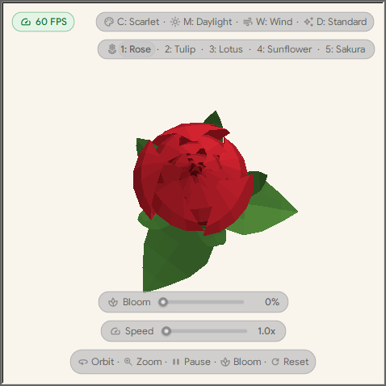
  <br>
  <em>15-second flagship gameplay showcase: Rose bloom unfurling, wind sway, Lotus, Sunflower, and Sakura in Twilight dark mode.</em>
</p>

---

## What's Inside

- **5 Flower Species** — Rose, Tulip, Lotus, Sunflower, and Sakura, each with an opening bloom animation and multiple color varieties (cultivars).
- **4 Lighting Moods** — Daylight, Golden, Sage, and Twilight (dark mode).
- **Interactive Motion** — Toggleable gentle wind breeze, live **Speed** and **Bloom** sliders, and smooth mouse orbit and zoom.
- **Detail Modes & Live Face Count** — Switch between **Standard** (60 FPS) and **Lush** detail anytime, with a live mesh face count pill (`len(faces)`).
- **Ambient BGM Engine** — Pure Python streaming background music player looping `.m4a` tracks in `assets/audios/` with real-time 4-band audio spectrum bars, track time, previous/next skipping, hotkeys, and smooth dynamic label resizing.
- **On-Screen HUD** — Clickable pills and sliders styled with bundled `Google Sans` fonts and `Material Symbols` icons, plus a custom window icon.

---

## Gameplay Showcases (10~15s Live Previews)

All clips are recorded directly from the live application at 10 FPS with local 256-color palettes (zero compression artifacts):

| Showcase | Live Preview | Duration & Details |
|---|:---:|---|
| **01. Full Gameplay Tour** |  | **15s**<br>Grand tour: bud-to-bloom unfurling, Noir cultivar, wind breeze, Lotus in Sage, Sunflower in Golden, and Sakura in Twilight. |
| **02. Rose Bloom & Orbit** | 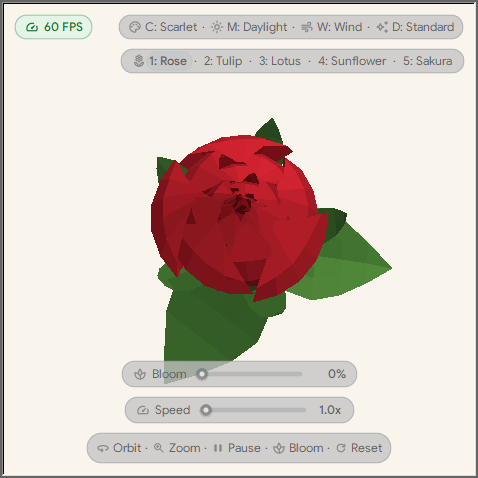 | **12s**<br>Scarlet Rose opening from closed bud (0%) to full blossom (100%), followed by 360° camera orbit & zoom. |
| **03. Species Gallery** | 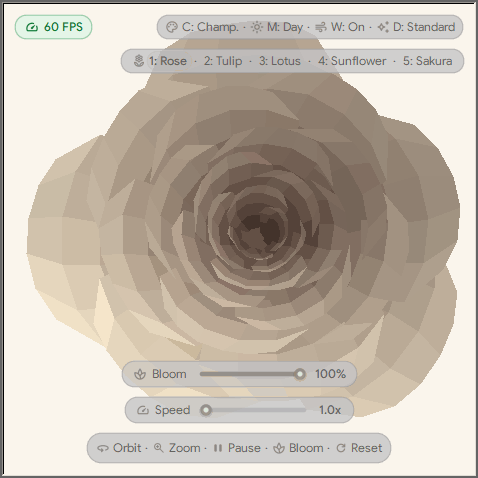 | **15s**<br>Tour across all 5 botanical species: Rose (Champagne), Tulip (Crimson), Lotus (Gold), Sunflower (Velvet), and Sakura (Yaezakura). |
| **04. Lighting Moods & Wind** | 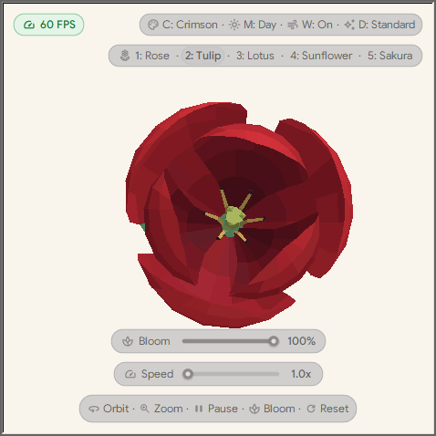 | **12s**<br>Tulip swaying organically with wind breeze active while transitioning Daylight &rarr; Golden &rarr; Sage &rarr; Twilight. |
| **05. Lotus Twilight Unfurl** | 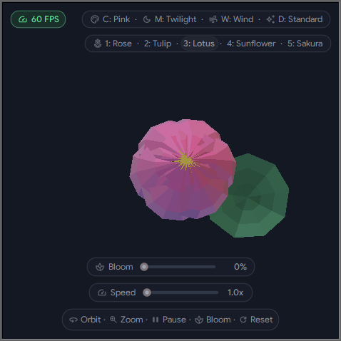 | **10s**<br>Sacred Lotus bud unfurling petals and pistils in dark Twilight mood with gentle aquatic breeze. |
| **06. Sunflower Golden Orbit** | 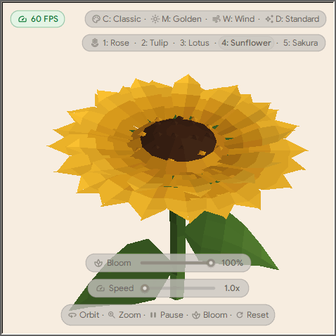 | **12s**<br>Classic Sunflower rotating in warm golden hour lighting, tilting to reveal the golden-angle seed disc pattern. |
| **07. Tulip Cultivars & Breeze** |  | **12s**<br>Cycling Tulip color varieties: Crimson, Apricot, Ivory, Violet, and Golden with organic wind sway. |
| **08. Sakura Twilight Breeze** | 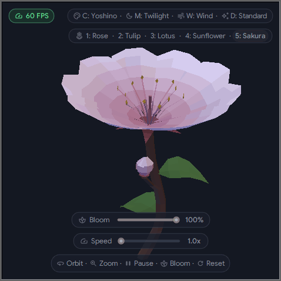 | **10s**<br>Delicate Yoshino Sakura cherry blossom petals swaying in the evening wind under Twilight dark mode. |
| **09. Rose Cultivars Palette** | 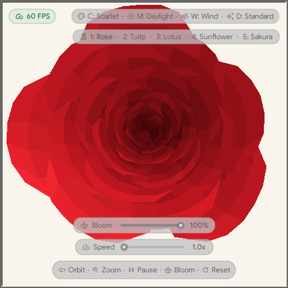 | **12s**<br>Cycling all Rose cultivar varieties: Scarlet, Champagne, Blush, Amber, Noir, and Coral. |
| **10. Interactive Zoom & Tilt** | 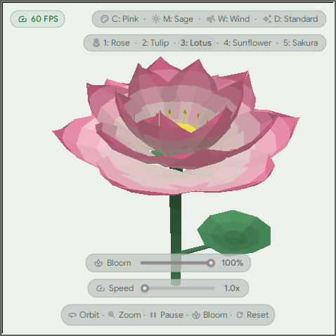 | **10s**<br>Demonstrating smooth camera orbit, elevation tilt, and deep zoom into intricate petal structures. |
| **11. Speed & Motion Controls** | 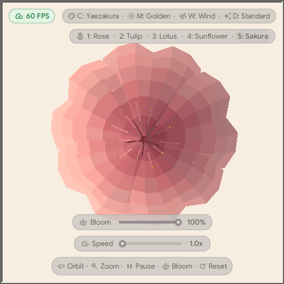 | **10s**<br>Live speed slider adjustment from gentle 1.0x to 4.0x fast spin and smooth deceleration. |
| **12. Lush Detail Comparison** | 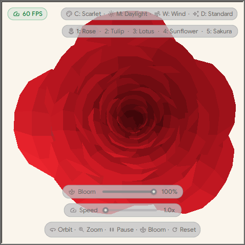 | **10s**<br>Live switch from Standard mesh tier (60 FPS) to Lush high-detail tessellation tier. |

---

## Run

Requires **Python 3.10+** with standard `tkinter`/`turtle` support (no `pip install` needed):

```bash
python flowers_3d.py
```

On Windows, the app automatically detaches via `pythonw.exe` so no terminal window stays open behind it (pass `--no-detach` to keep console output).

---

## Controls

Click the on-screen HUD buttons/sliders directly, or use keyboard and mouse shortcuts:

| Input | Action |
| --- | --- |
| **Mouse Drag** / **Arrow Keys** | Orbit and tilt camera |
| **Mouse Wheel** / **`+`** **`-`** | Zoom in and out |
| **Speed / Bloom Sliders** | Adjust spin speed (`1.0x`–`5.0x`) or bloom (`0%`–`100%`) |
| **`Shift + Scroll`** | Adjust bloom openness (`±5%`) |
| **`1`–`5`** / **`F`** | Pick or cycle flower (Rose, Tulip, Lotus, Sunflower, Sakura) |
| **`C`** | Cycle color variety (cultivar) |
| **`M`** | Cycle lighting mood (Daylight, Golden, Sage, Twilight) |
| **`W`** | Toggle wind breeze |
| **`T`** | Toggle Standard / Lush detail tier |
| **`A`** | Play / Pause BGM (ambient music) |
| **`S`** / **`D`** | Previous / Next BGM track |
| **`Space`** | Pause / resume auto-rotation |
| **`B`** / **`R`** | Replay bloom (`B`) or reset view (`R`) |
| **`F11`** / **`Esc`** | Toggle fullscreen (`F11`) or exit (`Esc`) |

---

## Project Structure

```text
Draw-a-flower/
├── .github/workflows/
│   └── pages.yml        # GitHub Actions workflow deploying preview.html to GitHub Pages
├── flowers_3d.py        # 3D flower geometry, lighting, animation, HUD & app loop
├── preview.html         # Interactive visual gallery to live-preview all showcase GIFs
├── README.md            # Project guide with embedded live showcase previews
├── .gitignore           # Ignores __pycache__ and compiled Python files
├── showcases/           # 12 recorded 10~15s gameplay showcase GIFs & recorder
│   ├── record_showcases.py  # Zero-dependency headless recorder
│   ├── 01_full_gameplay_tour_15s.gif
│   ├── 02_rose_bloom_and_orbit_12s.gif
│   ├── 03_species_gallery_15s.gif
│   ├── 04_lighting_moods_and_wind_12s.gif
│   ├── 05_lotus_twilight_unfurl_10s.gif
│   ├── 06_sunflower_golden_orbit_12s.gif
│   ├── 07_tulip_cultivars_and_breeze_12s.gif
│   ├── 08_sakura_twilight_breeze_10s.gif
│   ├── 09_rose_cultivars_palette_12s.gif
│   ├── 10_interactive_zoom_and_tilt_10s.gif
│   ├── 11_speed_and_motion_controls_10s.gif
│   └── 12_lush_detail_comparison_10s.gif
└── assets/
    ├── rose_icon.png    # App icon (PNG)
    ├── rose_icon.ico    # Windows window & taskbar icon
    ├── audios/          # Ambient BGM tracks (.m4a)
    ├── fonts/           # Bundled Google Sans fonts & OFL.txt
    └── icons/           # 16 HUD icons & Apache-2.0 LICENSE
```

---

## Credits

- **Antigravity**: This whole project was fully made with Antigravity.
- **Fonts & Icons**: `Google Sans` ([`OFL.txt`](assets/fonts/OFL.txt)) and `Google Material Symbols` ([`LICENSE`](assets/icons/LICENSE)).
- **Ambient Music**: Erik Satie – Gymnopédie No. 1 & Claude Debussy – Clair de Lune (Public Domain / Creative Commons).
